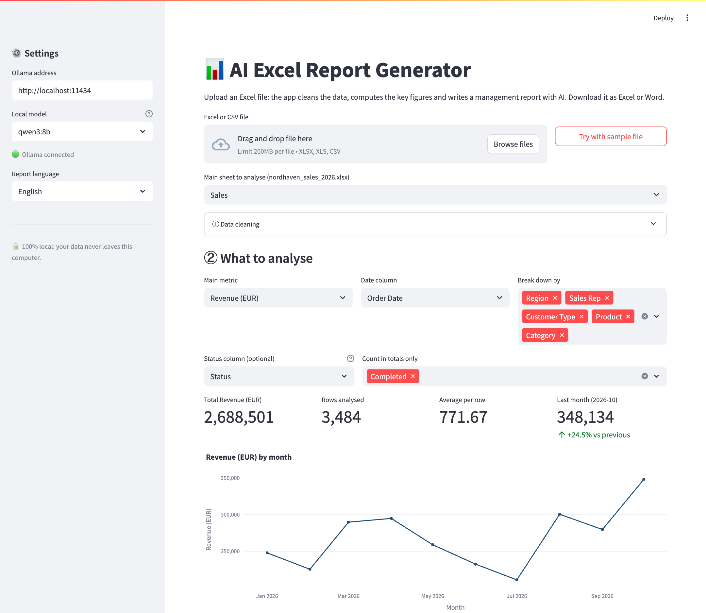
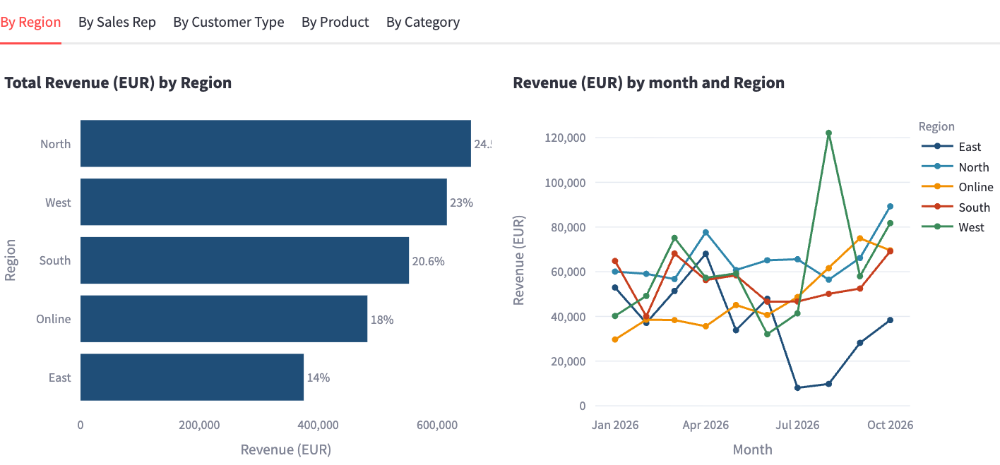
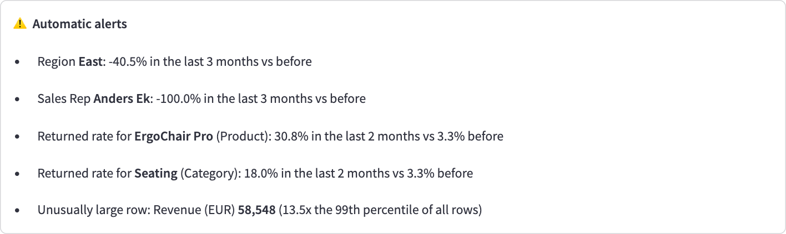
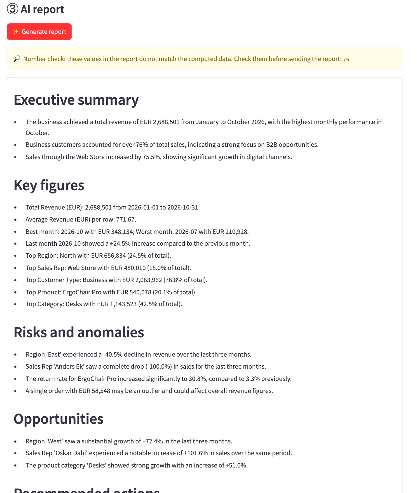

# AI Excel Report Generator

**Upload an Excel file, get a management report written by AI, with charts, ready to download as Excel or Word. Runs 100% locally.**



## Why

Many teams spend hours every month turning the same spreadsheets into the same report. This app does it in a couple of minutes: it cleans the data, computes the figures, spots what changed and writes the commentary.

General-purpose chatbots can invent or miscalculate numbers. This app is built so that the AI **does not have to calculate anything**: Python computes the figures, and the AI is instructed only to explain them.

## What it does

1. **Reads** every sheet of an `.xlsx`, `.xls` or `.csv` file.
2. **Cleans** the data: removes duplicates and empty rows, trims text, recognises dates, counts missing values.
3. **Detects the structure** on its own: date column, main metric (revenue, sales, amount…), categories to break it down by, and status columns (completed / returned / cancelled).
4. **Computes** the figures with pandas: monthly trend, rankings, segments that grew or dropped sharply, single rows far above normal, and status rates that spiked (for example returns).
5. **Writes the report with a local LLM** through [Ollama](https://ollama.com) (default `qwen3:8b`): executive summary, key figures, risks, opportunities, recommended actions and data-quality notes, in 7 languages.
6. **Checks the AI text**: most numbers in the report are compared with the computed findings, and values that appear nowhere in them are flagged for review (see [Limits of the number check](#limits-of-the-number-check)).
7. **Exports** the report to Excel (native charts + cleaned data), Word (formatted, with charts and tables) or Markdown.

| Breakdown by segment | Automatic alerts |
|---|---|
|  |  |



*A real run with `qwen3:8b`: the model rounded "76.8%" to "over 76%", and the number check flagged it.*

## How the app reduces made-up numbers

```
Excel ──▶ pandas cleaning ──▶ pandas analytics ──▶ computed findings (plain sentences)
                                                         │
                                                         ▼
                                   local LLM: prioritise, explain, translate, recommend
                                                         │
                                                         ▼
                                 number check: flags figures not found in the findings
```

Small local models (7-8B) make mistakes when they read raw tables or do arithmetic. So the app turns every computed fact into a short, ready-made sentence, and the model only has to rephrase and prioritise. A final check parses the numbers in the AI output (both `1,234.5` and `1.234,5` formats) and flags values that are not in the findings.

### Limits of the number check

The check is a safety net, not a guarantee, so read the report before sending it:

- Whole numbers up to 31 (including percentages such as `25%`) and dates like `2026-10` are skipped.
- It checks that a value exists in the findings, not that it is attached to the right item: a correct figure assigned to the wrong region is not flagged.
- It does not check signs (growth or drop), numbers written in words, or the reasoning in the text.

## Setup

1. Install [Ollama](https://ollama.com) and download the model:

```bash
ollama pull qwen3:8b
```

2. Install and start the app:

```bash
python3 -m venv .venv
source .venv/bin/activate
pip install -r requirements.txt
streamlit run app.py
```

3. Click **Try with sample file** to see a demo with fictional sales data.

You can pick any installed model in the sidebar. To change the default model or the Ollama address, copy `.env.example` to `.env`. On a 16 GB laptop, 7-8B models take about 1-3 minutes per report. If Ollama is not running, the app falls back to **demo mode** with a rule-based summary built from the same figures.

## Sample data

`sample_data/nordhaven_sales_2026.xlsx` is a fictional company's sales file (Jan-Oct 2026, about 3,700 orders) with realistic patterns hidden in it, so you can check that the app finds them: a region that collapses after a sales rep leaves, a product whose return rate spikes, a single huge B2B order, a summer dip, plus messy data (duplicates, missing values, stray spaces). Regenerate it with `python sample_data/generate_sample_excel.py`.

## Files

| File | Role |
|---|---|
| `app.py` | Streamlit interface |
| `analysis.py` | Loading, cleaning, profiling and insight extraction |
| `ai_summary.py` | Findings, local model call (Ollama), number check, demo mode |
| `report_export.py` | Excel / Word export |
| `sample_data/` | Fictional sales file and the script that generates it |

## Privacy

With the default settings the model runs on your computer, so the app sends your data to no external AI service and there is no cost per report. The model does not receive the full table: it gets the computed findings, the file and sheet names, and the details of single rows flagged as outliers.

## Tech stack

Python · pandas · Streamlit · Plotly · Ollama (local LLM) · openpyxl · python-docx · matplotlib

## Author

Valerio Romanazzi · Data Scientist · [LinkedIn](https://www.linkedin.com/in/valerio-romanazzi-5264971b5/)
